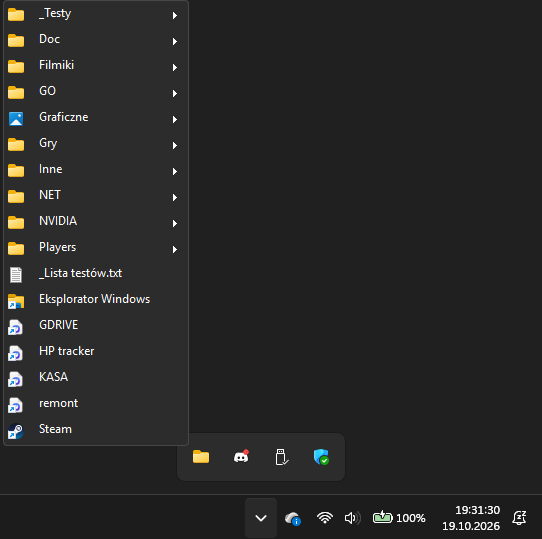
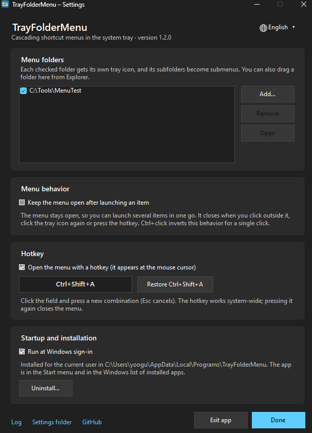

<p align="center">
  
</p>

<h1 align="center">TrayFolderMenu</h1>

<p align="center">
  <b>Cascading folder menus in the Windows&nbsp;11 system tray.</b><br>
  The taskbar toolbars from Windows&nbsp;10 – back, as a single tiny executable.
</p>

<p align="center">
  <a href="https://github.com/damiankowalski/TrayFolderMenu/releases/latest"></a>
  <a href="https://github.com/damiankowalski/TrayFolderMenu/releases"></a>
  <a href="https://github.com/damiankowalski/TrayFolderMenu/actions/workflows/build.yml"></a>
  <a href="LICENSE"></a>
  
</p>

<p align="center">
  <a href="https://github.com/damiankowalski/TrayFolderMenu/releases/latest"><b>Download</b></a> ·
  <a href="#quick-start">Quick start</a> ·
  <a href="docs/deployment.md">Deployment&nbsp;(Intune)</a> ·
  <a href="CHANGELOG.md">Changelog</a> ·
  <a href="README.pl.md">Polski</a>
</p>

<!--
  Screenshots: save them as docs/images/menu.png and docs/images/settings.png, then remove this comment.
  -->
<p align="center">
  
  
</p>

## Why

Windows 10 let you turn any folder into a taskbar toolbar: one click, and the whole folder tree opened as a cascading menu.
Windows 11 removed the feature. **TrayFolderMenu** brings it back as a lightweight tray app – point it at a folder and its tray icon
becomes that menu. Already have a toolbar folder from Windows 10? It works as is.

## Features

- **Menus built from plain folders** – subfolders become submenus; shortcuts (`.lnk`), internet shortcuts (`.url`), documents and
  scripts launch with a click. The menu is built every time it opens, so changes show up immediately.
- **Several menus at once** – every folder you add gets its own tray icon.
- **Global hotkey** – <kbd>Ctrl</kbd>+<kbd>Shift</kbd>+<kbd>A</kbd> (configurable) opens the menu at the mouse cursor.
- **Launch several items in one go** – optionally keep the menu open after a click; <kbd>Ctrl</kbd>+click inverts the behavior for
  a single click.
- **English and Polish** – switch the language on the fly with the globe button in the settings window; by default the app
  follows the Windows display language.
- **Native look** – Windows 11 style menus with rounded corners, light and dark mode following the system, Explorer icons and
  Explorer-like natural sorting.
- **No admin rights, no dependencies** – one ~100&nbsp;KB executable running on the .NET Framework 4.8 that ships with Windows.
  Optional per-user install with autostart, a Start menu entry and an *Installed apps* entry.
- **Deployment-friendly** – silent `/install` and `/uninstall`, a preset folder via `/folder:`, plain JSON configuration.
  See [docs/deployment.md](docs/deployment.md) for Microsoft Intune.
- **Private by design** – no network access, no telemetry, no update checks.

## Requirements

- Windows 10 (version 1903 or later) or Windows 11
- .NET Framework 4.8 – already part of these Windows versions

## Download

1. Download **`TrayFolderMenu.exe`** from the [latest release](https://github.com/damiankowalski/TrayFolderMenu/releases/latest).
   The `.zip` asset contains the same executable with the README and license.
2. The executable is not code-signed yet, so Microsoft Defender SmartScreen may warn on first launch – choose
   **More info → Run anyway**. You can verify the file against `SHA256SUMS.txt` from the release:

   ```powershell
   Get-FileHash .\TrayFolderMenu.exe -Algorithm SHA256
   ```

Release binaries are built by [GitHub Actions](.github/workflows/build.yml) directly from the tagged source code.
Prefer to compile it yourself? See [Build from source](#build-from-source).

## Quick start

1. Run `TrayFolderMenu.exe` – the settings window opens.
2. Click **Add…** and pick a folder, or drag a folder from Explorer onto the list. A tray icon appears.
3. Optional: click **Install for current user**. The app copies itself to
   `%LOCALAPPDATA%\Programs\TrayFolderMenu`, starts at sign-in and appears in the Start menu and in *Installed apps*.
   Without installing, the executable simply runs portable.
4. To change the language, click the globe button (**English ▾**) in the top-right corner of the settings window.

> [!TIP]
> Windows 11 may hide new tray icons under the **^** overflow arrow. Drag the icon onto the taskbar, or turn it on in
> **Settings → Personalization → Taskbar → Other system tray icons**.

## Usage

| Action | Result |
|---|---|
| Left-click the tray icon | Opens the folder's cascading menu; click again to close it |
| Right-click the tray icon | Settings, open the folder in Explorer, keep-menu-open toggle, run at sign-in, exit |
| <kbd>Ctrl</kbd>+<kbd>Shift</kbd>+<kbd>A</kbd> | Opens the menu at the mouse cursor (with several folders, one submenu each); press again to close |
| Click an item | Launches it; clicking a folder opens it in Explorer |
| <kbd>Ctrl</kbd>+click an item | Launches it and inverts the *keep menu open* setting for that click |
| <kbd>Esc</kbd> or a click outside the menu | Closes the menu |

**What the menu shows:** folders first, then files, in natural order (*Item 2* before *Item 10*). `.lnk` and `.url` files are shown
without extensions. Hidden files – including `desktop.ini` – are skipped, while custom folder icons are respected.

## Settings

| Section | Options |
|---|---|
| **Language** (globe button, top right) | English or Polski – applied instantly |
| **Menu folders** | Add, remove, open and enable/disable folders; drag & drop from Explorer |
| **Menu behavior** | Keep the menu open after launching an item |
| **Hotkey** | Enable/disable the global hotkey; click the field and press a new combination |
| **Startup and installation** | Run at sign-in; install, update or uninstall |

Settings are stored in `%APPDATA%\TrayFolderMenu\config.json` and can also be edited by hand or deployed:

```json
{
  "Folders": [
    { "Path": "C:\\Tools\\Menu", "Enabled": true }
  ],
  "HotkeyEnabled": true,
  "Hotkey": "Ctrl+Shift+A",
  "KeepMenuOpen": false,
  "Language": "en"
}
```

`Language` is `"en"` or `"pl"`; without it, the app follows the Windows display language. The configuration format, the registry
entries and the log are the same – and in English – whatever language the interface uses, so switching languages never changes
how settings are stored.

## Command line

| Switch | Effect |
|---|---|
| *(none)* | Starts the app and opens the settings window (if already running, shows its window) |
| `/autostart` | Starts silently in the tray – used by the sign-in entry |
| `/install [/quiet] [/folder:"C:\Menu"] [/language:en\|pl]` | Installs for the current user, enables autostart and starts the app |
| `/uninstall [/quiet]` | Uninstalls (asks about removing settings unless `/quiet`) |
| `/exit` | Closes the running instance |
| `/?` | Shows help |

## Files and registry

| Location | Purpose |
|---|---|
| `%LOCALAPPDATA%\Programs\TrayFolderMenu\TrayFolderMenu.exe` | Installed executable |
| `%APPDATA%\TrayFolderMenu\config.json` | Settings |
| `%LOCALAPPDATA%\TrayFolderMenu\log.txt` | Log in English (rotated at 1&nbsp;MB) |
| `HKCU\Software\Microsoft\Windows\CurrentVersion\Run` → `TrayFolderMenu` | Run at sign-in |
| `HKCU\Software\Microsoft\Windows\CurrentVersion\Uninstall\TrayFolderMenu` | *Installed apps* entry |
| Start menu → `TrayFolderMenu` | Opens the settings window |

Nothing is written to `HKLM` or `Program Files`. There is no service, driver or scheduled task.

## Updating

Run the new version with `/install`:

```powershell
.\TrayFolderMenu.exe /install
```

It closes the running instance, replaces the installed executable and starts the new version. Your settings are kept.

## Uninstalling

Use **Uninstall…** in the settings window, **Settings → Apps → Installed apps → TrayFolderMenu → Uninstall**,
or run `TrayFolderMenu.exe /uninstall`.

## Deployment

TrayFolderMenu installs per user without admin rights, which makes it easy to deploy with Microsoft Intune, Configuration Manager
or a sign-in script. [docs/deployment.md](docs/deployment.md) covers install and uninstall commands, detection rules, pre-configured
folders and notes for application control policies.

## Build from source

No Visual Studio, SDK or NuGet packages are needed – the C# compiler that ships with Windows is enough:

```cmd
git clone https://github.com/damiankowalski/TrayFolderMenu.git
cd TrayFolderMenu
build.cmd
```

The result is `dist\TrayFolderMenu.exe`. Because the build uses `csc.exe` from .NET Framework 4.8
(`%WINDIR%\Microsoft.NET\Framework64\v4.0.30319`), the source code is limited to C# 5.

```
├── src/
│   ├── TrayFolderMenu.cs     the whole application
│   ├── app.manifest          DPI awareness, Windows 10/11 compatibility, asInvoker
│   └── TrayFolderMenu.ico
├── docs/                     deployment guide and images
├── build.cmd                 local build
└── .github/workflows/        CI build and release publishing
```

## FAQ

<details>
<summary><b><kbd>Ctrl</kbd>+<kbd>Shift</kbd>+<kbd>A</kbd> stopped working in my browser.</b></summary>

A global hotkey takes priority over shortcuts inside applications – in Chrome and Edge this combination searches open tabs.
Change the hotkey in the settings window, or turn it off.
</details>

<details>
<summary><b>Why can't I use <kbd>Ctrl</kbd>+<kbd>Alt</kbd>+<i>letter</i> as the hotkey?</b></summary>

You can, but on many keyboard layouts (Polish, German and others) <kbd>Ctrl</kbd>+<kbd>Alt</kbd> acts as <kbd>AltGr</kbd>, so the hotkey
would block typing characters such as *ą* or *ę*. The settings window warns about it.
</details>

<details>
<summary><b>Does the interface language affect my settings?</b></summary>

No. Only the interface text changes. Configuration keys and values, registry entries, the Start menu shortcut and the log are always
in English, so a configuration file deployed by an administrator works the same for every user.
</details>

<details>
<summary><b>Does it need admin rights or install anything system-wide?</b></summary>

No. Everything lives in your user profile and your part of the registry (`HKCU`).
</details>

<details>
<summary><b>Why does it use a global mouse hook?</b></summary>

Only while a menu is kept open after launching an item. The launched program takes the focus, so the app needs another way to notice
a click outside the menu. The low-level mouse hook runs on its own thread, never blocks clicks and is removed as soon as the menu closes.
There is no keyboard hook.
</details>

<details>
<summary><b>Can the menu folder be on a network share?</b></summary>

Yes – any path works, including UNC paths such as `\\server\share\Menu`. This is a simple way to manage shortcuts centrally.
On slow connections, opening large submenus may take a moment, because the menu is read when it opens.
</details>

## Contributing

Bug reports and ideas are welcome in [Issues](https://github.com/damiankowalski/TrayFolderMenu/issues).
See [CONTRIBUTING.md](CONTRIBUTING.md) before opening a pull request, and [SECURITY.md](SECURITY.md) for reporting vulnerabilities.

## License

[MIT](LICENSE) © 2026 Damian Kowalski
