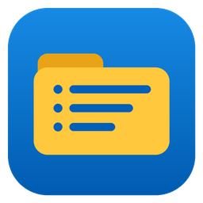

<p align="center">
  
</p>

<h1 align="center">TrayFolderMenu</h1>

<p align="center">
  <b>Kaskadowe menu folderów w zasobniku Windows&nbsp;11.</b><br>
  Paski narzędzi z Windows&nbsp;10 wracają – jako jeden mały plik exe.
</p>

<p align="center">
  <a href="https://github.com/damiankowalski/TrayFolderMenu/releases/latest"><b>Pobierz</b></a> ·
  <a href="#szybki-start">Szybki start</a> ·
  <a href="docs/deployment.md">Wdrożenie&nbsp;(Intune, EN)</a> ·
  <a href="CHANGELOG.md">Zmiany</a> ·
  <a href="README.md">English</a>
</p>

## Po co to?

W Windows 10 dowolny folder można było dodać do paska zadań jako pasek narzędzi: jedno kliknięcie i całe drzewo folderu otwierało
się jako kaskadowe menu. Windows 11 usunął tę funkcję. **TrayFolderMenu** przywraca ją jako lekką aplikację w zasobniku:
wskazujesz folder, a jego ikona w zasobniku staje się tym menu. Folder z dawnego paska narzędzi z Windows 10 działa bez zmian.

## Możliwości

- **Menu prosto z folderów** – podfoldery stają się podmenu; skróty (`.lnk`), skróty internetowe (`.url`), dokumenty i skrypty
  uruchamiasz kliknięciem. Menu jest budowane przy każdym otwarciu, więc zmiany widać od razu.
- **Kilka menu naraz** – każdy dodany folder ma własną ikonę w zasobniku.
- **Globalny skrót** – <kbd>Ctrl</kbd>+<kbd>Shift</kbd>+<kbd>A</kbd> (do zmiany) otwiera menu przy kursorze myszy.
- **Kilka pozycji z jednego otwarcia** – menu może zostawać otwarte po kliknięciu; <kbd>Ctrl</kbd>+klik odwraca to zachowanie
  dla pojedynczego kliknięcia.
- **Po polsku i po angielsku** – język zmienisz w locie przyciskiem z globusem w oknie ustawień; domyślnie program
  używa języka Windows.
- **Natywny wygląd** – menu w stylu Windows 11 z zaokrąglonymi rogami, jasny i ciemny motyw zgodny z systemem, ikony
  i sortowanie jak w Eksploratorze.
- **Bez uprawnień administratora i zależności** – jeden plik exe (~100&nbsp;KB) na wbudowanym w Windows .NET Framework 4.8.
  Opcjonalna instalacja dla bieżącego użytkownika z autostartem, skrótem w menu Start i wpisem na liście aplikacji.
- **Gotowe do wdrożeń** – ciche `/install` i `/uninstall`, folder ustawiany przez `/folder:`, konfiguracja w JSON.
  Opis wdrożenia przez Intune: [docs/deployment.md](docs/deployment.md).
- **Prywatność** – brak dostępu do sieci, telemetrii i sprawdzania aktualizacji.

## Wymagania

- Windows 10 (wersja 1903 lub nowsza) albo Windows 11
- .NET Framework 4.8 – wbudowany w te wersje Windows

## Pobieranie

1. Pobierz **`TrayFolderMenu.exe`** z [najnowszego wydania](https://github.com/damiankowalski/TrayFolderMenu/releases/latest).
   Plik `.zip` zawiera ten sam program razem z README i licencją.
2. Plik nie jest jeszcze podpisany cyfrowo, więc SmartScreen może ostrzec przy pierwszym uruchomieniu – wybierz
   **Więcej informacji → Uruchom mimo to**. Zgodność pliku sprawdzisz z `SHA256SUMS.txt` z wydania:

   ```powershell
   Get-FileHash .\TrayFolderMenu.exe -Algorithm SHA256
   ```

Pliki w wydaniach buduje [GitHub Actions](.github/workflows/build.yml) bezpośrednio z otagowanego kodu źródłowego.
Wolisz skompilować sam? Zobacz [Kompilacja](#kompilacja).

## Szybki start

1. Uruchom `TrayFolderMenu.exe` – otworzy się okno ustawień.
2. Kliknij **Dodaj…** i wybierz folder albo przeciągnij go z Eksploratora na listę. W zasobniku pojawi się ikona.
3. Opcjonalnie kliknij **Zainstaluj dla bieżącego użytkownika**. Program skopiuje się do
   `%LOCALAPPDATA%\Programs\TrayFolderMenu`, będzie startował po zalogowaniu i pojawi się w menu Start oraz na liście aplikacji.
   Bez instalacji działa jako wersja przenośna.
4. Język zmienisz przyciskiem z globusem (**Polski ▾**) w prawym górnym rogu okna ustawień.

> [!TIP]
> Windows 11 może schować nową ikonę pod strzałką **^** w zasobniku. Przeciągnij ją na pasek zadań albo włącz w
> **Ustawienia → Personalizacja → Pasek zadań → Inne ikony zasobnika systemowego**.

## Obsługa

| Akcja | Efekt |
|---|---|
| Lewy klik ikony | Otwiera kaskadowe menu folderu; ponowny klik je zamyka |
| Prawy klik ikony | Ustawienia, otwarcie folderu w Eksploratorze, przełącznik „nie zamykaj menu”, autostart, zamknięcie |
| <kbd>Ctrl</kbd>+<kbd>Shift</kbd>+<kbd>A</kbd> | Menu przy kursorze (przy kilku folderach każdy jako podmenu); ponowne naciśnięcie zamyka |
| Klik pozycji | Uruchamia ją; klik folderu otwiera go w Eksploratorze |
| <kbd>Ctrl</kbd>+klik pozycji | Uruchamia ją i odwraca ustawienie „nie zamykaj menu” dla tego kliknięcia |
| <kbd>Esc</kbd> albo klik poza menu | Zamyka menu |

**Co pokazuje menu:** najpierw foldery, potem pliki, w naturalnej kolejności („Plik 2” przed „Plik 10”). Pliki `.lnk` i `.url`
są wyświetlane bez rozszerzeń. Pliki ukryte, w tym `desktop.ini`, są pomijane, a własne ikony folderów – zachowane.

## Ustawienia

Okno ustawień ma przełącznik języka (globus w prawym górnym rogu) i cztery sekcje: **Foldery menu**, **Zachowanie menu**,
**Skrót klawiszowy** oraz **Uruchamianie i instalacja**.
Ustawienia są zapisywane w `%APPDATA%\TrayFolderMenu\config.json` – plik można też edytować ręcznie lub wdrażać:

```json
{
  "Folders": [
    { "Path": "C:\\Tools\\Menu", "Enabled": true }
  ],
  "HotkeyEnabled": true,
  "Hotkey": "Ctrl+Shift+A",
  "KeepMenuOpen": false,
  "Language": "pl"
}
```

`Language` przyjmuje `"en"` lub `"pl"`; bez tego klucza program używa języka Windows. Format konfiguracji, wpisy w rejestrze
i log są takie same – po angielsku – niezależnie od języka interfejsu, więc zmiana języka nigdy nie zmienia sposobu zapisu ustawień.

## Przełączniki wiersza poleceń

| Przełącznik | Działanie |
|---|---|
| *(brak)* | Uruchamia program i otwiera ustawienia (gdy już działa – pokazuje jego okno) |
| `/autostart` | Uruchamia po cichu w zasobniku – używane przez autostart |
| `/install [/quiet] [/folder:"C:\Menu"] [/language:en\|pl]` | Instaluje dla bieżącego użytkownika, włącza autostart i uruchamia program |
| `/uninstall [/quiet]` | Dezinstaluje (bez `/quiet` pyta o usunięcie ustawień) |
| `/exit` | Zamyka działającą instancję |
| `/?` | Pokazuje pomoc |

## Pliki i rejestr

| Lokalizacja | Przeznaczenie |
|---|---|
| `%LOCALAPPDATA%\Programs\TrayFolderMenu\TrayFolderMenu.exe` | Zainstalowany program |
| `%APPDATA%\TrayFolderMenu\config.json` | Ustawienia |
| `%LOCALAPPDATA%\TrayFolderMenu\log.txt` | Log po angielsku (rotacja przy 1&nbsp;MB) |
| `HKCU\Software\Microsoft\Windows\CurrentVersion\Run` → `TrayFolderMenu` | Autostart |
| `HKCU\Software\Microsoft\Windows\CurrentVersion\Uninstall\TrayFolderMenu` | Wpis na liście aplikacji |

Program nie zapisuje nic w `HKLM` ani w `Program Files`. Nie instaluje usług, sterowników ani zadań harmonogramu.

## Aktualizacja i dezinstalacja

Nową wersję uruchom z przełącznikiem `/install` – zamknie działającą instancję, podmieni plik i uruchomi program ponownie.
Ustawienia zostają bez zmian.

Dezinstalacja: przycisk **Odinstaluj…** w ustawieniach, **Ustawienia → Aplikacje → Zainstalowane aplikacje → TrayFolderMenu**
albo `TrayFolderMenu.exe /uninstall`.

## Kompilacja

Nie potrzeba Visual Studio, SDK ani pakietów NuGet – wystarczy kompilator C# wbudowany w Windows:

```cmd
git clone https://github.com/damiankowalski/TrayFolderMenu.git
cd TrayFolderMenu
build.cmd
```

Wynik: `dist\TrayFolderMenu.exe`. Kompilacja używa `csc.exe` z .NET Framework 4.8, dlatego kod jest zgodny z C# 5.

## Licencja

[MIT](LICENSE) © 2026 Damian Kowalski
